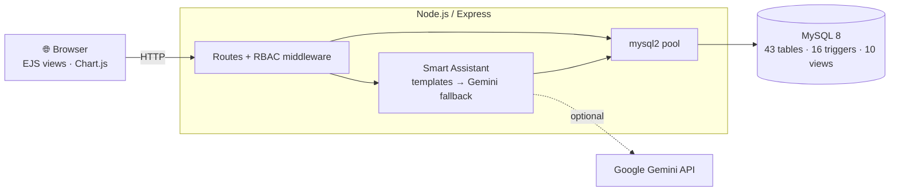

<div align="center">

# 🐔 Smart Poultry Farm Management System

### A full-stack, database-driven platform for running commercial broiler operations


*CSE221 – Database Systems · Faculty of Computer Science and Engineering · Galala University · Spring 2026*

</div>

---

## 📖 Overview

Commercial poultry farming runs on thin margins and strict biological limits. Paper-based tracking leads to missed mortality spikes, poor feed-conversion ratios (FCR) and untraceable losses.

**Smart Poultry Farm** replaces it with one system: a normalized (**3NF**) MySQL schema of **43 tables, 16 triggers and 10 views**, fronted by a Node.js / Express web app. It covers the whole farm lifecycle (breeding cycles, daily telemetry, inventory, suppliers, B2B sales and invoicing, equipment maintenance, HR and payroll, quality control and an audit trail) behind **role-based access control**, plus an **AI assistant** that answers questions in English and Arabic.

The key idea: **business rules live in the database.** Triggers reject impossible data (selling more birds than are alive, overdrawing stock, logging into a closed cycle), so integrity holds regardless of the client.

## ✨ Features

- **Production cycles:** one active cycle per shed (trigger-enforced), breed targets, worker assignment, auto-close when the flock is sold out or lost
- **Daily operations:** temperature, humidity, ammonia, water, feed and mortality logs with date and flock-size validation
- **Health management:** treatments, vaccination schedules and records, with automatic stock deduction
- **Supply chain:** suppliers, purchase orders, feed / medicine / vaccine stock across storage locations
- **Commercial:** customers, sales orders, sales, invoices and payments
- **Finance & reports:** expenses by category and per-cycle profit computed from SQL views
- **HR:** attendance, payroll, performance reviews, training sessions and enrollments
- **Quality control & maintenance:** QC inspections, device registry, usage cost, technician maintenance records
- **Smart Assistant:** bilingual (EN/AR) query templates with an optional **Gemini** fallback that generates read-only SQL
- **Audit trail:** significant actions logged with user, entity and IP address
- **UI:** auto-refreshing tables, Chart.js dashboard, dark / light theme, QR code to open the app on a phone

## 🏗️ Architecture



| Layer | Technology |
|---|---|
| **Database** | MySQL 8.0 (InnoDB), triggers, views, composite indexes, CHECK constraints |
| **Backend** | Node.js, Express 5, `mysql2/promise`, `express-session`, `bcryptjs`, `helmet`, `express-rate-limit` |
| **Frontend** | Server-rendered EJS, vanilla JS, Chart.js, Font Awesome, Inter font |
| **AI** | Template matcher (EN/AR) + Google Gemini (`@google/generative-ai`) |

## 🗄️ Database Design

Full documentation: [Report](docs/Database_Report.pdf) · [EERD](docs/EERD.pdf) · [Relational diagram](docs/Relational_Diagram.pdf) · [Workbench model](docs/relational_model.mwb)

### Business rules enforced by triggers

| Trigger | Rule |
|---|---|
| `before_insert_cycle` | Only one active cycle per shed |
| `before_insert_daily_log` / `_treatment` / `_expense` | Date must fall inside the cycle period and the cycle must be active |
| `before_insert_vaccination_record` | No vaccination before its scheduled date |
| `after_insert_vaccination_record` | Marks the schedule *Completed* |
| `trg_deduct_medicine_stock` / `_feed_stock` / `_vaccine_stock` | Auto-deduct stock, with overdraw pre-check |
| `before_insert_sale` | Can't sell more birds than are alive |
| `before_insert_mortality` | Mortality can't exceed the living flock |
| `after_insert_sale_autoclose` / `after_insert_mortality_autoclose` | Auto-close the cycle when all birds are sold or lost |
| `before_insert_sale_order_check` / `after_insert_sale_update_order` | Sale must match its order's cycle and customer, then marks the order *Delivered* |
| `before_insert_performance_review` | Review date between hire date and today |

**Views:** `v_worker_details` · `v_customer_financial_summary` · `v_cycle_status` · `Cycle_Living_Birds` · `Cycle_Feed_Cost` · `Cycle_Profit` · `Inventory_Status` · `Treatment_Details` · `Worker_Attendance_Summary` · `Worker_Payroll_Summary`

## 🔐 Roles

Three roles (**Manager**, **Farmer Worker**, **Technician**) plus an **Admin** flag. The sidebar adapts to the role: managers see every module, farmer workers see daily logs, treatments, QC and cycle overview, and technicians see maintenance, device registry, QC and training. Only the admin can create new accounts.

## 🚀 Getting Started

**Prerequisites:** Node.js 20+, MySQL 8.0+

```bash
# 1. Clone and install
https://github.com/smsosa1000/Smart-Poultry-Farm-MS.git
npm install

# 2. Configure (set DB_PASSWORD to your MySQL password)
cp .env.example .env            # Windows: copy .env.example .env

# 3. Create the schema, then load demo data
node scripts/run_schema.js
node scripts/seed_v6.js

# 4. Start the app
node server.js
```

Open **http://localhost:5000**. The console also prints a network URL for other devices on the same Wi-Fi.

> ⚠️ `run_schema.js` **drops and recreates** the `smartpoultryfarm` database and `seed_v6.js` **truncates all tables**. Use them on a development database only. Run all commands from the project root.

### Demo accounts

| Role | Username | Password |
|---|---|---|
| Manager + Admin | `admin1234` | `admin1234` |
| Manager | `manager2` | `admin1234` |
| Farmer Worker | `farmwork1234` | `farmwork1234` |
| Technician | `tech1234` | `tech1234` |

Other seeded staff use their username as the password (for example `monaz1005`). These are demo accounts only.

### Environment variables

| Variable | Description |
|---|---|
| `DB_HOST` / `DB_USER` / `DB_PASSWORD` / `DB_NAME` | MySQL connection |
| `PORT` | HTTP port (default `5000`) |
| `SESSION_SECRET` | Signs session cookies |
| `GEMINI_API_KEY` | Optional, enables the AI fallback ([get a key](https://aistudio.google.com/app/apikey)) |

## 🤖 Smart Assistant

Ask in English or Arabic, e.g. *"How many birds have died?"* or *"إجمالي النفوق"*. Known questions are answered instantly by parameterized SQL templates; anything else goes to Gemini, which drafts a read-only `SELECT` that the server validates (mutations blocked, role-based table restrictions, 100-row cap) before running it.

## 📁 Project Structure

```
smart-poultry-farm/
├── ai/                          # Smart Assistant (templates + Gemini fallback)
├── config/db.js                 # MySQL connection pool
├── middleware/                  # Authentication and RBAC
├── routes/                      # One module per feature area
├── views/                       # EJS templates (partials, auth, pages)
├── public/                      # CSS and client-side JS
├── scripts/                     # Database setup, seeding and one-off maintenance
│   ├── run_schema.js            #   loads DB_Project_Code_Clean.sql
│   └── seed_v6.js               #   demo data
├── docs/                        # Report, presentation, EERD, relational model
├── DB_Project_Code_Clean.sql    # Full schema: tables, triggers, views, indexes
├── server.js                    # App entry point
└── .env.example                 # Config template
```

## 🔮 Future Work

- IoT sensors for automatic temperature / humidity capture
- Predictive analytics for mortality and FCR
- CSV / PDF export for reports and invoices
- Email / SMS alerts for low stock and overdue vaccinations
- Automated tests and CI, Docker Compose setup

## 👥 Team

**Supervised by Prof. Shaker El-Sappagh**, Galala University

**Samaa Mohamed Saleh** · **Omar Khalifa** · **Mariam El Zayat** · **Ahmed Mohamed Ahmed** · **Basmala Gamal Mohamed**

## 📄 License

Developed for academic purposes as part of CSE221 (Database Systems) at Galala University.
